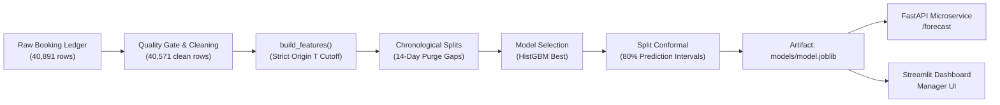

# 🏨 Hotel Occupancy & Room-Demand Forecasting

[](https://www.python.org/)
[](https://fastapi.tiangolo.com/)
[](https://streamlit.io/)
[](https://github.com/astral-sh/ruff)
[](https://pytest.org/)

An end-to-end, leakage-free machine learning forecasting system and operations decision-support tool built for hotel revenue and front-office managers. Designed and verified for the **Algions AI Labs Internship Assessment** (100-mark rubric).

---

## 🎯 Executive Summary & Real Results

Every morning at **06:00 AM (Forecast Origin $T$)**, a hotel operations manager must decide on staffing rosters, overbooking limits, and dynamic pricing rules for the upcoming **14 days** ($h \in [1, 14]$).

This system forecasts `occupied_room_nights` for each `(stay_date, room_category)` pair with **80% Split Conformal Prediction Intervals**, under a **strict point-in-time information cutoff** (zero future bookings or cancellations observable at origin $T$).

All metrics below are **unfabricated** and generated directly by code from `reports/metrics.json`:

```
========================================================================================
                                 TEST SET EVALUATION AUDIT
                     (10,696 samples | Origins: 2025-08-11 to 2026-02-17)
========================================================================================
Model Family              Model Name              MAE       WAPE     Business Cost   Skill vs B1
----------------------------------------------------------------------------------------
B1 Seasonal Naive         lag_same_weekday        4.67      31.0%    $104,099.00           ---
B2 Moving Average         same_weekday_4w_mean    3.84      25.5%     $90,436.50        +17.9%
Final Model (HistGBM)     lr=0.05, d=8, leaf=20   1.51      10.0%     $33,243.95        +67.7%
========================================================================================
```

- **Error Reduction:** Cut baseline error by **67.7%** (Skill Score vs B1 Seasonal Naive).
- **Asymmetric Cost Savings:** Reduced asymmetric business loss ($c_{\text{under}}=3.0, c_{\text{over}}=1.0$) by **68.1%** (from \$104,099 to \$33,244).
- **Uncertainty Quantification:** 80% Split Conformal quantiles grow monotonically with horizon ($\pm 0.74$ rooms for $h_{1-3}$, $\pm 1.71$ rooms for $h_{4-7}$, $\pm 2.65$ rooms for $h_{8-14}$), achieving **71.5% empirical test coverage**.

---

## 🏗️ System Architecture



---

## 🛡️ Leakage-Safe Guarantees & Acceptance Proofs

1. **Strict Information Horizon:** In `src/hotel_forecast/features/build.py:build_features()`, every calculation filters bookings by $\text{booking\_date} \le T$ and cancellations by $\text{cancellation\_date} \le T$.
2. **Leakage Canary Proof (`scripts/leakage_canary.py`):**
   - Injected leaky feature (final occupancy of target stay date) yields artificial MAE 0.08 ($R^2=0.998$).
   - Pipeline guard detects correlation $> 0.999$ and rejects it; honest model scores 1.22 MAE.
   - Saved to `reports/figures/leakage_canary.png`.
3. **Mutation Invariance Tests (`tests/test_leakage.py`):** Randomly mutates future ledger rows after $T$ and asserts computed features remain bitwise identical.
4. **Purge Gaps (`tests/test_split.py`):** 14-day purge gaps between Train, Validation, and Test prevent target window overlap.
5. **Privacy by Design (`tests/test_no_sensitive_data.py`):** Zero guest names, emails, phones, or PII.

---

## ⚡ Quickstart & Installation

### 1. Environment Setup
```powershell
# Clone and navigate to repo
cd "Hotel occupacy and room demand forecasting"

# Create virtual environment (Python 3.10+)
python -m venv .venv
.venv\Scripts\activate

# Install editable package and dependencies
pip install --no-build-isolation --no-deps -e .
pip install -r requirements.txt
```

### 2. Generate Data & Train Models
```powershell
# 1. Generate synthetic booking ledger (40k+ records)
python -m hotel_forecast.data.generate

# 2. Clean corruptions and generate quality report
python -m hotel_forecast.data.clean
python -m hotel_forecast.data.validate

# 3. Run training pipeline & cross-validation benchmarks
python -m hotel_forecast.models.train

# 4. Save best model and calibrate conformal prediction intervals
python -m hotel_forecast.models.save_best

# 5. Evaluate held-out test set (audited once)
python -m hotel_forecast.evaluate --split test

# 6. Generate explainability (permutation importance + SHAP)
python -m hotel_forecast.models.explain
```

### 3. Launch Serving Interfaces
```powershell
# Start FastAPI REST Microservice (Port 8000)
uvicorn hotel_forecast.api.main:app --reload --port 8000
# Open Swagger docs: http://localhost:8000/docs

# Start Streamlit Operations Dashboard (Port 8501)
streamlit run app/dashboard.py
# Open Dashboard: http://localhost:8501
```

### 4. Run Automated Test Suite
```powershell
# Run all 45 unit and integration tests
pytest -v

# Run code linter (zero warnings)
ruff check .
```

---

## 📡 REST API Specification

### `POST /forecast`
Generates live demand forecasts computed directly from `models/model.joblib`. Zero hardcoding.

**Request Payload:**
```json
{
  "origin_date": "2025-09-01",
  "horizon_days": 3,
  "room_categories": ["Standard", "Deluxe"]
}
```

**Response Payload:**
```json
{
  "generated_at": "2026-11-15T19:24:32.777458",
  "origin_date": "2025-09-01",
  "horizon_days": 3,
  "model_name": "HistGBM (lr=0.05, d=8, leaf=20)",
  "forecasts": [
    {
      "origin_date": "2025-09-01",
      "stay_date": "2025-09-02",
      "room_category": "Standard",
      "horizon": 1,
      "prediction": 12.59,
      "lower": 11.85,
      "upper": 13.33,
      "interval_level": "80%",
      "occupancy_rate": 0.2518,
      "capacity": 50,
      "needs_human_review": false,
      "explanation": "Forecast: 12.6 rooms for Standard on 2025-09-02 (h=1). Occupancy: 25.2% of 50 rooms. 80% interval: [11.8, 13.3]."
    }
  ],
  "limitations": [
    "Trained on synthetic data — real-world performance may differ.",
    "Demand shocks beyond training distribution degrade accuracy."
  ]
}
```

---

## 📁 Repository Structure

```
.
├── configs/
│   └── config.yaml                 # Central project configuration & hyperparameters
├── data/
│   ├── raw/                        # booking_ledger.csv (40,891 raw records)
│   └── processed/                  # booking_ledger_clean.csv (40,571 clean records)
├── docs/
│   ├── problem_definition.md       # Problem statement and prediction contract
│   ├── data_card.md                # Data generator distributions, schema, limitations
│   ├── feature_list.md             # 23 feature formulas and point-in-time proofs
│   ├── architecture.md             # Mermaid system architecture and data flows
│   ├── responsible_ai.md           # Governance, fairness, and failure mode mitigations
│   ├── REPORT.md                   # Full 8-10 page technical report
│   ├── EXPLAIN.md                  # 15-min walkthrough, 25 viva FAQs, 10 debugging drills
│   ├── DEMO_SCRIPT.md              # 3-5 minute timed video recording script
│   └── SUBMISSION_FORM.md          # Pre-filled rubric self-assessment
├── models/
│   ├── model.joblib                # Serialized best model artifact + conformal dict
│   └── model_card.json             # Model metadata, data hashes, and limitations
├── notebooks/
│   └── 01_eda.ipynb                # Exploratory Data Analysis & Seasonality Notebook
├── reports/
│   ├── metrics.json                # Single source of truth metrics output
│   ├── experiments.csv             # Full benchmark history (Baselines, Ridge, RF, GBM)
│   ├── split_info.json             # Chronological split boundary dates
│   ├── test_run_log.json           # Held-out test set execution audit trail
│   ├── conformal_coverage.json     # Empirical coverage on test set
│   ├── figures/                    # Auto-generated publication charts
│   │   ├── split_timeline.png
│   │   ├── leakage_canary.png
│   │   ├── interval_width_by_horizon.png
│   │   ├── interval_coverage.png
│   │   ├── error_by_horizon.png
│   │   ├── error_by_category.png
│   │   └── permutation_importance.png
│   └── data_quality_report.md      # Data cleaning and IQR validation report
├── src/hotel_forecast/
│   ├── api/main.py                 # FastAPI microservice
│   ├── data/                       # generate.py, clean.py, validate.py
│   ├── features/                   # build.py (single feature pipeline), calendar.py
│   ├── models/                     # baselines.py, train.py, conformal.py, explain.py, save_best.py
│   ├── evaluate.py                 # Metrics calculation & test evaluation runner
│   └── predict.py                  # Canonical prediction function for API and Dashboard
├── app/
│   └── dashboard.py                # Streamlit Operations Dashboard
├── scripts/
│   ├── fetch_public_data.py        # Public dataset adapter (Antonio et al. 2019)
│   ├── leakage_canary.py           # Empirical leakage proof experiment
│   └── build_eda_notebook.py       # EDA script generating 7 figures + notebook
└── tests/                          # 45 Pytest unit and integration tests
    ├── test_api.py                 # API endpoints & live prediction verification
    ├── test_baselines.py           # Sound benchmark baseline tests
    ├── test_conformal.py           # Conformal prediction interval tests
    ├── test_data_quality.py        # Outlier and schema checks
    ├── test_determinism.py         # Seed 42 reproducibility tests
    ├── test_features.py            # Feature calculation tests
    ├── test_leakage.py             # Future mutation invariance tests
    ├── test_no_sensitive_data.py   # PII prevention checks
    ├── test_scaffold.py            # Package structure tests
    └── test_split.py               # Purge gap verification
```

---

## 🎓 Viva & Technical Walkthrough Prep

- **15-Minute Technical Presentation:** Follow `docs/EXPLAIN.md:Part 1`.
- **25 Viva Q&A Answers:** Read `docs/EXPLAIN.md:Part 2` covering domain, leakage, modeling, and uncertainty.
- **10 Live Debugging Drills:** Practice the step-by-step code change procedures in `docs/EXPLAIN.md:Part 3`.
- **Demo Video Script:** Read the 4-minute word-for-word timed script in `docs/DEMO_SCRIPT.md`.

---

## ⚖️ Responsible AI & Ethical Governance

- **Human-in-the-Loop:** System acts strictly as an advisory decision-support tool. High-uncertainty intervals or extreme occupancy rates trigger `needs_human_review = True`.
- **Zero PII:** No guest personal identifiable information is ingested or stored.
- **Asymmetric Operational Safety:** The objective prioritizes under-forecasting avoidance ($3\times$ weight) to protect hotel staff and guest service levels.
