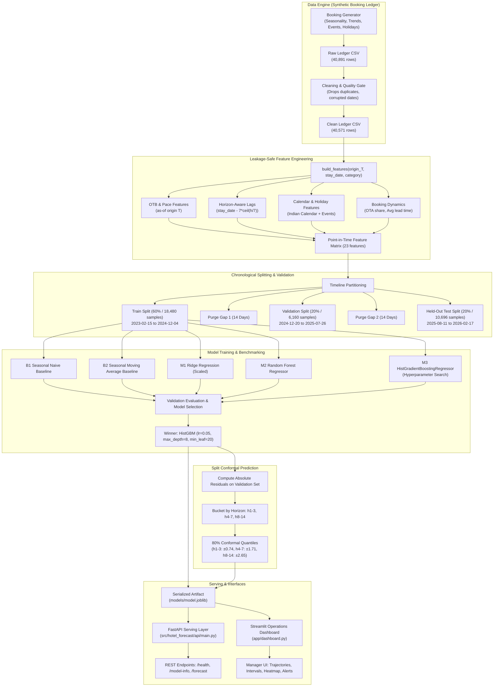
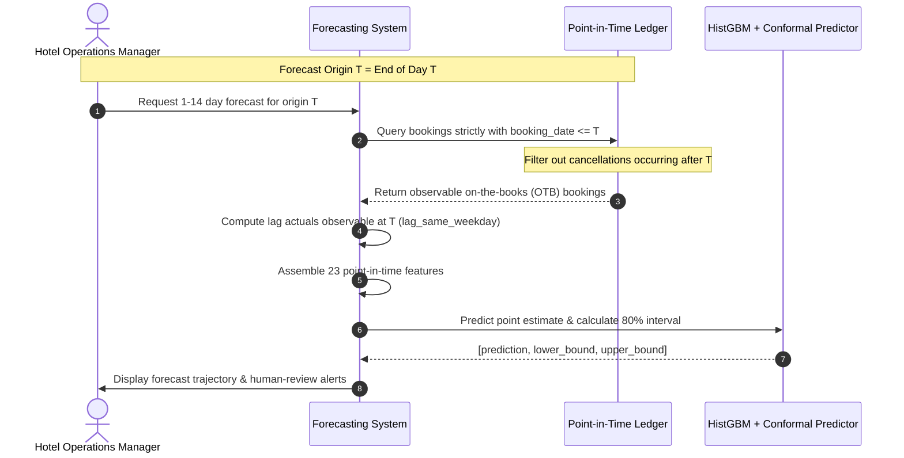

# System Architecture: Hotel Occupancy & Room-Demand Forecasting

## 1. End-to-End System Flow

---

## 2. Information Horizon and Point-in-Time Constraint

---

## 3. Data Flow and Guardrails

1. **Zero Future Leakage:** All feature computation is centralized in `src/hotel_forecast/features/build.py:build_features()`. Every sub-query filters on `booking_date <= origin_T` and `cancellation_date <= origin_T`.
2. **Purge Gaps:** 14-day gap between training, validation, and test splits prevents overlapping multi-step horizon targets from contaminating adjacent partitions.
3. **Capacity Bounds:** All point predictions and conformal bounds are clipped to $[0, \text{capacity}]$ for physical realism.
4. **Asymmetric Loss Function:** Objective weights under-forecasting ($c_{\text{under}}=3.0$) $3\times$ higher than over-forecasting ($c_{\text{over}}=1.0$).
